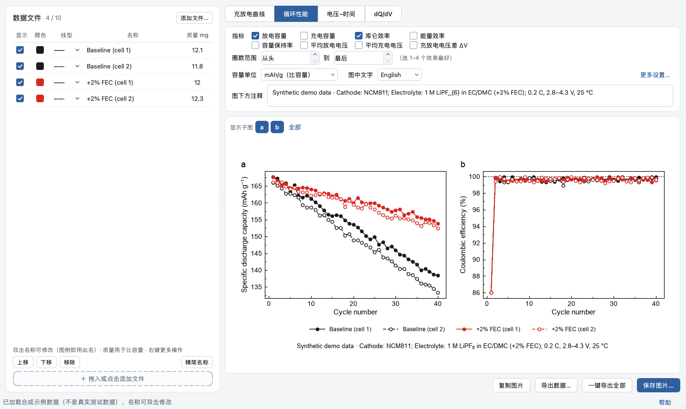

<p align="center"></p>

<h1 align="center">GalvaPlot · 电池数据一键作图</h1>

<p align="center">把蓝电（LAND）<code>.cex</code> 或新威（Neware）<code>.ndax</code> 源文件拖进窗口，一键画出可以直接放进 PPT 和论文的电化学图。</p>

<p align="center"></p>

## 适合谁

做电池、电化学和材料方向的硕士生、博士生：测完电池，想马上把几个电池的充放电曲线、循环性能放在一张图里对比，放进组会 PPT，不想每次都导出 Excel 再到 Origin 里一列一列地复制。

## 能做什么

| 图 | 内容 |
|---|---|
| **充放电曲线** | 指定圈数的电压–容量曲线。可以每圈一个子图、比较不同电池，也可以每个电池一个子图、比较不同圈（颜色由浅到深） |
| **循环性能** | 放电/充电容量、库仑效率、能量效率、容量保持率、平均充/放电电压、ΔV，任选 1–8 个，自动排成多子图 |
| **电压–时间** | 整个测试过程的电压曲线，可叠加或每个电池一个子图，用来检查异常 |
| **dQ/dV** | 指定圈数的微分容量曲线，可调电压间隔和平滑 |

- **最多 10 个文件**同时对比，蓝电和新威的文件可以混在一起；支持直接拖入整个文件夹
- **曲线名称可随意改**：文件名再乱也没关系，双击改成图例里想要的名字；“精简名称”可以一键去掉日期和所有文件都有的部分
- 下标、上标不用学 LaTeX：`AlCl_{3}` → AlCl₃，`Li^{+}` → Li⁺
- 颜色、线型逐条可调（平行样可以同色、不同线型）
- 容量单位：mAh、mAh/g（填活性物质质量）、mAh/cm²（填面积）、相对参考圈的 %
- 图下方可写**测试条件**（正极、电解液、电流密度…），每张图都带上
- 图中文字可选**英文或中文**
- **复制图片**后直接粘贴到 PPT/Word；也可保存为 PNG（默认 300 dpi）、SVG、PDF、TIFF
- **导出数据**为 Excel：每条曲线两列，加上每个电池的逐圈数据，可直接导入 Origin
- **一键导出全部**：4 种图（PNG + SVG）和数据一次保存到一个文件夹
- 读取快：10 个 80 MB 左右的文件（共约 2000 万个数据点）约 1–2 秒读完

图的风格：Arial 字体、刻度朝内带次刻度、无边框图例、多子图自动加 a/b/c 编号，配色按色觉障碍友好的顺序排列。

## 下载安装（不用装 Python）

到本页右侧的 **[Releases](../../releases)** 下载最新版本（注意：不是绿色的 “Code → Download ZIP”，那是源代码）。

| 系统 | 下载哪个文件 | 怎么装 |
|---|---|---|
| **Windows 10/11（推荐）** | `GalvaPlot-版本号-Windows-Setup.exe` | 双击安装包，一路“Next”。默认只装给当前用户，**不需要管理员密码**；会建开始菜单项和桌面图标 |
| Windows 免安装版 | `GalvaPlot-版本号-Windows-x64-portable.zip` | **先完整解压**，再双击文件夹里的 `GalvaPlot.exe`（在压缩软件里直接双击会打不开）。适合放 U 盘或没有安装权限的电脑 |
| **macOS（Apple 芯片：M1–M5）** | `GalvaPlot-版本号-macOS-AppleSilicon.dmg` | 双击打开，把 GalvaPlot 图标拖到旁边的“Applications（应用程序）”文件夹 |

Intel 芯片的 Mac 和 Linux 暂时没有安装包，请用下面的“从源码运行”。

### 第一次打开时的提示（正常现象）

程序是免费开源软件，没有购买代码签名证书，所以系统会提示一次：

- **Windows**：出现“Windows 已保护你的电脑”时，点“**更多信息**”→“**仍要运行**”。
- **macOS**：提示“无法验证开发者 / Apple 无法检查其是否包含恶意软件”时，打开“**系统设置 → 隐私与安全性**”，在页面下方点“**仍要打开**”。
  如果提示“**已损坏，无法打开**”，在“终端”里运行下面一行后再打开：
  ```bash
  xattr -dr com.apple.quarantine /Applications/GalvaPlot.app
  ```
- **360、火绒等安全软件**有时会把没有签名的 Python 程序误报为病毒。代码完全公开，可以在安全软件里选择“信任”或把安装目录加入白名单。
- 第一次启动要等 10–30 秒（建立字体缓存，会显示提示窗口），以后打开只要 1–2 秒。

### 卸载

- Windows：“设置 → 应用 → 已安装的应用”里找到 GalvaPlot 卸载；免安装版直接删除文件夹。
- macOS：把“应用程序”里的 GalvaPlot 拖到废纸篓。

## 三步出图

1. 把 `.cex` / `.ndax` 文件拖进窗口（或点“添加文件…”）。没有数据可以先点“示例数据”试试。
2. 在左侧双击修改名称；需要比容量就填“质量 mg”。
3. 在右侧选图的类型和圈数，点“复制图片”粘贴到 PPT，或“保存图片…”。

## 计算方法（请在论文/组会中按需说明）

| 量 | 定义 |
|---|---|
| 循环 | 蓝电：沿用文件里记录的循环号。新威：按工步程序里的“循环”步划分——循环开始前的充放电（例如首次放电）算第 1 圈，之后循环每执行一遍算一圈，与蓝电的编号方式一致；可能与 BTSDA 显示的循环号不同 |
| 充电/放电容量 | 同一循环内所有充电（或放电）工步容量之和；静置不计 |
| 库仑效率 | 默认 = 放电容量 ÷ 充电容量（同一循环）；负极半电池可在“更多设置”里改为 充电 ÷ 放电 |
| 能量效率 | 与库仑效率同方向，用能量计算 |
| 平均电压 | 工步能量 ÷ 工步容量 |
| ΔV | 平均充电电压 − 平均放电电压 |
| 容量保持率 / % 单位 | 放电容量 ÷ 参考圈放电容量；参考圈默认是第一个有放电的循环 |
| dQ/dV | 电压每变化设定值（默认 5 mV）取一个点做差分，再做滑动平均；放电为负值 |
| 未完成的最后一圈 | 最后一圈比上一圈少工步，或最后一步既没到截止电压、也没到上一圈的时长/容量，就视为“可能未完成”（测试仍在进行或中途停止），循环图中默认不画，界面下方会提示；可在“更多设置”里保留 |

只有画图时会对曲线抽点（电压–时间图），所有计算都用完整的原始数据。

## 支持的文件

- **蓝电 `.cex` 源文件**。`.icex` 是索引文件，不含数据，请拖同名的 `.cex`。
- **新威 `.ndax` 源文件**（BTS 8.x 写出的版本，内部格式 v17）。旧版 `.nda` 和其他版本的 `.ndax` 暂不支持，程序会提示；可以在 BTSDA 里导出 Excel 再拖进来。辅助通道（温度等）暂不读取。
- 蓝电软件导出的 **Excel / CSV / TXT**（实验功能）：程序按表头自动识别“电压、电流、时间、容量、循环号、工步号、工步状态”等列，中英文表头都可以，单位从表头读取（V/mV、A/mA/μA、Ah/mAh、s/min/h）。请抽查几个循环的容量是否与蓝电软件一致。

### 关于文件格式（请务必读）

蓝电和新威都没有公开源文件格式，本程序的读取方法是**逆向得到的**：

- **蓝电 `.cex`**：用一个实验室蓝电测试仪的 143 个文件（共约 7600 万个数据点）做过内部一致性检查：记录的容量与 ∫|I|dt、能量与 ∫V|I|dt 一致，设定电流与实测电流一致，充放电工步的电流符号正确；并与独立编写的另一版解析器逐文件比对一致。
- **新威 `.ndax`**：用 BTS Client 8.0 写出的 26 个文件检查过：331 个充放电工步的记录容量与 ∫|I|dt 的比值中位数为 1.000000，能量与 ∫V|I|dt 一致（差异来自 30 s 采样间隔），所有数据点的电流符号与工步类型一致，重建的测试时间与记录里的系统时间一致（差 ≤ 77 s，系统时间只精确到秒）。
- **都还没有与官方软件导出逐点比对**。参考文件里只有静置、恒流充电、恒流放电三种工步；遇到恒压、恒流恒压、脉冲等其他工步，程序按电流方向判断充电/放电/静置，并在界面上提示。
- 重要数据（尤其是论文数据）请与蓝电 / BTSDA 软件核对。

如果你的文件读不了或结果不对，欢迎[提交 issue](../../issues)，最好附上文件（或用测试数据复现的文件）和蓝电软件中的对应数值，我们会尽快适配。

## 从源码运行

需要 Python 3.9 或更高版本：

```bash
git clone https://github.com/690463389xkc-collab/galvaplot.git
cd galvaplot
python -m pip install -r requirements.txt
python -m galvaplot
```

运行测试（不需要真实数据，测试用程序自带的合成数据）：

```bash
python -m unittest discover -s tests -v
```

自己打包：

```bash
python -m pip install pyinstaller
pyinstaller --noconfirm galvaplot.spec                                            # 程序本体（dist/）
bash tools/make_dmg.sh dist/GalvaPlot.app dist/GalvaPlot-0.1.0-macOS-AppleSilicon.dmg   # macOS 安装镜像
```

Windows 安装包用 [Inno Setup 6](https://jrsoftware.org/isinfo.php) 制作：`ISCC.exe /DMyAppVersion=0.1.0 installer\galvaplot.iss`。

发布新版本：改 `galvaplot/__init__.py` 里的版本号，推送 `v*` 标签（例如 `v0.1.0`）。GitHub Actions 会在三个系统上跑测试，然后自动生成 Windows 安装包、Windows 免安装 zip 和 macOS dmg，并模拟用户安装后再自检一遍（Windows：静默安装 → 运行 → 卸载；macOS：挂载 dmg → 拷出程序 → 运行），全部通过才上传到 Releases。

## 项目结构

```
galvaplot/
  readers/land_cex.py   蓝电 .cex 读取（格式说明见文件开头）
  readers/neware_ndax.py 新威 .ndax 读取（格式说明见文件开头）
  readers/tabular.py    Excel / CSV 导入（实验功能）
  analysis.py           逐圈指标、充放电曲线、dQ/dV
  plotting/figures.py   4 种图；plotting/style.py 字体、配色
  plotting/export.py    Excel 导出
  gui/                  PySide6 界面
  demo.py               合成示例数据（也用于测试）
installer/galvaplot.iss  Windows 安装包脚本（Inno Setup）
tools/make_dmg.sh       macOS dmg 制作脚本
tests/                  单元测试
```

## 参与贡献

欢迎提交 issue 和 pull request，尤其是：其他型号或软件版本的 `.cex` / `.ndax` 文件适配、新的图类型、英文界面。提交代码前请先跑一遍测试。

## 许可与声明

- 开源协议：[MIT](LICENSE)。
- 本项目是个人开源项目，与武汉市蓝电电子股份有限公司、深圳市新威尔电子有限公司无关；“蓝电”“LAND”“新威”“Neware”是其各自所有者的商标。
- 程序按“现状”提供，计算结果请自行核对。

---

### English summary

**GalvaPlot** is a small desktop app for battery researchers. Drag up to 10 raw battery-tester files (LAND `.cex`, Neware `.ndax` from BTS 8.x) into the window and get publication-style figures in one click: voltage profiles, cycling metrics (capacity, coulombic/energy efficiency, retention, average voltages, ΔV), voltage vs time and dQ/dV. Curve names are editable (with `X_{sub}` / `X^{sup}` shortcuts), figures can be copied straight into PowerPoint or saved as PNG/SVG/PDF/TIFF, and plotted data can be exported to Excel. Both readers are reverse-engineered and checked for internal consistency (143 `.cex`, 26 `.ndax` files), but not yet against official exports — please verify important numbers. A Windows installer (per-user, no admin rights needed), a portable Windows zip and a macOS (Apple Silicon) disk image are on the Releases page; otherwise `pip install -r requirements.txt && python -m galvaplot`. MIT licensed; not affiliated with LAND or Neware.
